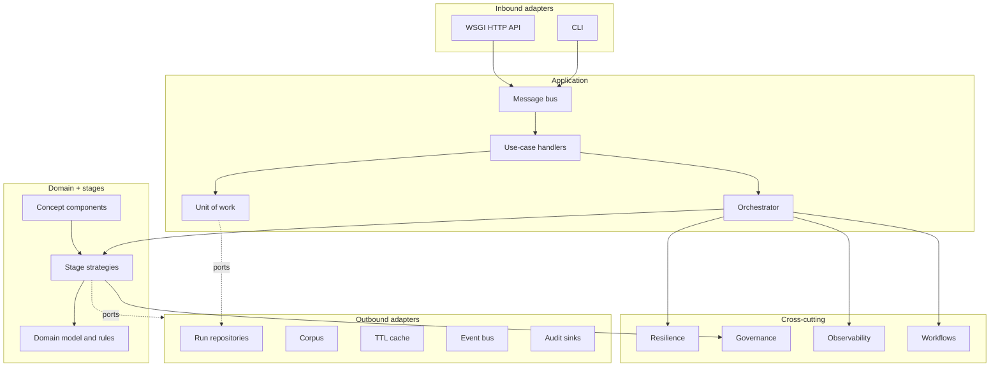
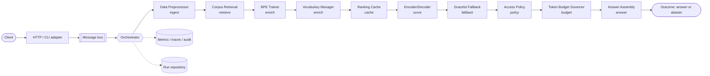
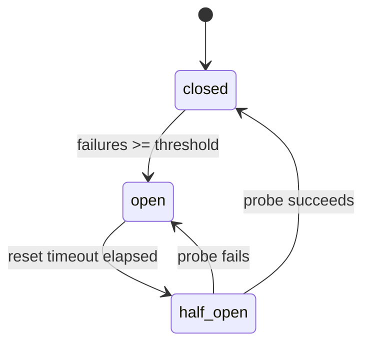
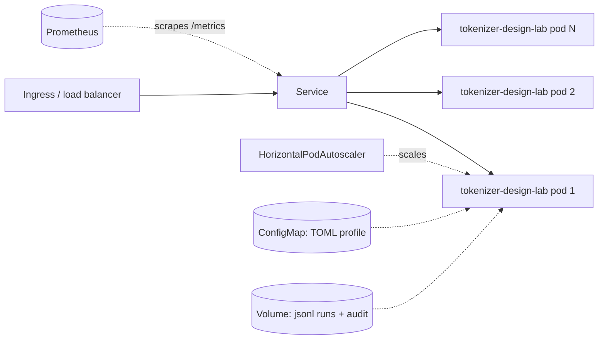

# Tokenizer Design Lab

Tokenizer Design Lab: Engineering Tokenization for Domain-Specific LLMs

[](.github/workflows/ci.yml)


This repository implements **Tokenizer Design Lab** as **Modular Hybrid Subword Tokenizer**. The concept path centres on **Data Preprocessor**, **BPE Trainer**, **Vocabulary Manager**, and **Encoder/Decoder**. In this design, scoring and ordering stay behind swappable ports, candidates can be annotated without coupling to infrastructure, and inbound requests are validated and bounded at the edge. The runtime uses only the Python standard library, so every behaviour in this README can be run and tested on a laptop in seconds.

## Contents

- [Why this exists](#why-this-exists)
- [Architecture at a glance](#architecture-at-a-glance)
- [Pipeline stages](#pipeline-stages)
- [Components](#components)
- [Quick start](#quick-start)
- [HTTP API](#http-api)
- [Configuration](#configuration)
- [Governance model](#governance-model)
- [Resilience model](#resilience-model)
- [Observability](#observability)
- [Design trade-offs](#design-trade-offs)
- [Failure modes](#failure-modes)
- [Project layout](#project-layout)
- [Testing strategy](#testing-strategy)
- [Extending the pipeline](#extending-the-pipeline)
- [Deployment](#deployment)
- [Design integrity](#design-integrity)
- [Limitations](#limitations)

## Why this exists

Enterprise domains present unique lexical challenges where standard tokenizers fail to capture specialized terminology efficiently. The core engineering problem is balancing the need for high-fidelity domain representation against the computational costs of vocabulary size and sequence length. Poor choices lead to high Out-Of-Vocabulary (OOV) rates or inefficient context window usage.

Subword tokenization (specifically BPE) is the superior architectural choice for enterprise LLMs because it dynamically adapts to domain-specific vocabulary without the rigidity of static lists. It effectively balances the trade-off between capturing morphological nuances of specialized terms and maintaining computational efficiency through optimized sequence lengths.

Most write-ups of Modular Hybrid Subword Tokenizer stop at a box diagram. This repository goes further: every box is a module, every arrow is a port, and every failure mode named in the design has a test that injects it.

## Architecture at a glance

**Tokenizer Design Lab** follows **Modular Hybrid Subword Tokenizer**.

Concept components and how they collaborate:

- **Data Preprocessor** (`ingest`): Cleans and normalizes domain-specific text to ensure consistent character encoding.

- **BPE Trainer** (`enrich`): Iteratively merges the most frequent pairs of adjacent symbols in the training corpus to build the vocabulary.

- **Vocabulary Manager** (`enrich`): Handles the serialization of the vocabulary and merge rules, supporting both loading and saving operations.

- **Encoder/Decoder** (`score`): Converts raw text strings into integer token IDs and vice-versa, handling special tokens (e.g., , ).

The service is hexagonal: inbound adapters (HTTP, CLI) drive an application bus; domain rules and stage strategies sit inside; outbound adapters implement ports for persistence, corpus access, caching, events, and audit. Only `container.py` wires concrete classes.



### Request flow



### Data flow

1. Data Preprocessor (ingest): Cleans and normalizes domain-specific text to ensure consistent character encoding.
2. BPE Trainer (enrich): Iteratively merges the most frequent pairs of adjacent symbols in the training corpus to build the vocabulary.
3. Vocabulary Manager (enrich): Handles the serialization of the vocabulary and merge rules, supporting both loading and saving operations.
4. Encoder/Decoder (score): Converts raw text strings into integer token IDs and vice-versa, handling special tokens (e.g., , ).

## Pipeline stages

For **Tokenizer Design Lab**, the default stage order is `data_preprocessor`, `corpus_retrieval`, `bpe_trainer`, `vocabulary_manager`, `ranking_cache`, `encoder_decoder`, `graceful_fallback`, `access_policy`, `token_budget_governor`, and `answer_assembly`. Stages are ordered by role so ingest comes first, policy and budget gates sit before release, and answer assembly is last. Override the topology with `pipeline.stages` in any profile or `TOKENIZER_DESIGN_LAB_PIPELINE__STAGES`.

| # | Stage | Role | Critical | Source |
|---|---|---|---|---|
| 1 | `data_preprocessor` (Data Preprocessor) | `ingest` | yes | [component](docs/components/data_preprocessor.md) |
| 2 | `corpus_retrieval` (Corpus Retrieval) | `retrieve` | no | built-in |
| 3 | `bpe_trainer` (BPE Trainer) | `enrich` | no | [component](docs/components/bpe_trainer.md) |
| 4 | `vocabulary_manager` (Vocabulary Manager) | `enrich` | no | [component](docs/components/vocabulary_manager.md) |
| 5 | `ranking_cache` (Ranking Cache) | `cache` | no | [component](docs/components/ranking_cache.md) |
| 6 | `encoder_decoder` (Encoder/Decoder) | `score` | no | [component](docs/components/encoder_decoder.md) |
| 7 | `graceful_fallback` (Graceful Fallback) | `fallback` | no | built-in |
| 8 | `access_policy` (Access Policy) | `policy` | yes | built-in |
| 9 | `token_budget_governor` (Token Budget Governor) | `budget` | no | [component](docs/components/token_budget_governor.md) |
| 10 | `answer_assembly` (Answer Assembly) | `answer` | yes | built-in |

## Components

| Component | Role | Responsibility |
|---|---|---|
| [Data Preprocessor](docs/components/data_preprocessor.md) | `ingest` | Cleans and normalizes domain-specific text to ensure consistent character encoding. |
| [BPE Trainer](docs/components/bpe_trainer.md) | `enrich` | Iteratively merges the most frequent pairs of adjacent symbols in the training corpus to build the vocabulary. |
| [Vocabulary Manager](docs/components/vocabulary_manager.md) | `enrich` | Handles the serialization of the vocabulary and merge rules, supporting both loading and saving operations. |
| [Encoder/Decoder](docs/components/encoder_decoder.md) | `score` | Converts raw text strings into integer token IDs and vice-versa, handling special tokens (e.g., , ). |
| [Ranking Cache](docs/components/ranking_cache.md) | `cache` | Short-circuits repeated identical requests with a TTL-bounded ranking cache keyed by principal. |
| [Token Budget Governor](docs/components/token_budget_governor.md) | `budget` | Enforces per-request and global token ceilings before evidence reaches the answer stage. |

Concept modules for **Tokenizer Design Lab** live under `src/tokenizer_design_lab/components/` (`data_preprocessor/`, `bpe_trainer/`, `vocabulary_manager/`, and `encoder_decoder/`). Each folder owns its config, port, service, validators, models, metrics, errors, and registry adapter.

## Quick start

```bash
python -m venv .venv && source .venv/bin/activate
pip install -e ".[dev]"
make test
python -m tokenizer_design_lab describe
python -m tokenizer_design_lab run examples/requests/governed_query.json
python -m tokenizer_design_lab serve --port 8080
```

Library use for **Tokenizer Design Lab**:

```python
from tokenizer_design_lab import build_container
from tokenizer_design_lab.application.commands import RunPipeline

container = build_container()
outcome = container.bus.handle(RunPipeline(request={
    "query": 'How does Tokenizer Design Lab address: Compare vocabulary choices across enterprise domains?',
    "principal": {"subject": "alice", "roles": ["reader"], "groups": ["eng"]},
    "candidates": [{"doc_id": "a", "text": 'Compare vocabulary choices across enterprise domains.', "score": 0.8}],
}))
print(outcome["status"], outcome.get("answer"))
```

## HTTP API

| Method | Path | Purpose |
|---|---|---|
| GET | `/healthz` | Liveness for **Tokenizer Design Lab** |
| GET | `/readyz` | Readiness (stages loaded, breakers closed, hooks healthy) |
| GET | `/metrics` | Prometheus exposition for this service |
| GET | `/v1/pipeline` | Stage topology for `tokenizer_design_lab` |
| POST | `/v1/runs` | Execute a run of this pipeline |
| GET | `/v1/runs` | Recent run summaries |
| GET | `/v1/runs/{run_id}` | Full run record including checkpoints |

A run returns HTTP `200` when completed or abstained. Errors share one envelope: `{"error": {"code", "message", "details"}, "request_id"}`. Full reference: [docs/api/http.md](docs/api/http.md) and [docs/api/openapi.yaml](docs/api/openapi.yaml).

## Configuration

Configuration for **Tokenizer Design Lab** follows precedence: code defaults < TOML profile (`--config` or `TOKENIZER_DESIGN_LAB_CONFIG`) < environment (`TOKENIZER_DESIGN_LAB_<SECTION>__<KEY>`). Unknown keys are rejected at startup.

Knobs that matter most for this design: `TOKENIZER_DESIGN_LAB_PIPELINE__TOP_K`, `TOKENIZER_DESIGN_LAB_CACHE__ENABLED`, `TOKENIZER_DESIGN_LAB_BUDGET__DEFAULT_TOKENS`, and `TOKENIZER_DESIGN_LAB_GOVERNANCE__REDACT_PII`.

```bash
TOKENIZER_DESIGN_LAB_PIPELINE__TOP_K=5 TOKENIZER_DESIGN_LAB_CACHE__ENABLED=false python -m tokenizer_design_lab config
```

Profiles: [`config/default.toml`](config/default.toml), `development.toml`, `production.toml`, `test.toml`. Reference: [docs/api/configuration.md](docs/api/configuration.md).

## Governance model

Governance for **Tokenizer Design Lab** is enforced by the stages in this pipeline (`budget` and `policy`).

- **Operation authorization:** callers need `run:create` before they can drive **Tokenizer Design Lab**.
- **Fail-closed access policy:** tenant, clearance, and ACL checks deny by default; if the policy stage fails, no candidate survives.
- **PII redaction:** e-mail, phone, SSN, and card numbers are redacted before text reaches answer assembly in **Tokenizer Design Lab**.
- **Budgets:** per-request token budgets are bounded by a hard ceiling before evidence is released.
- **Evidence-backed release:** answer assembly abstains when surviving evidence is insufficient for **Tokenizer Design Lab**.

Details: [docs/architecture/governance.md](docs/architecture/governance.md), [docs/architecture/security.md](docs/architecture/security.md).

## Resilience model

**Tokenizer Design Lab** treats `data_preprocessor`, `access_policy`, and `answer_assembly` as critical (failure stops or fails closed). Non-critical stages such as `corpus_retrieval`, `bpe_trainer`, `vocabulary_manager`, `ranking_cache`, and `encoder_decoder` degrade and continue when possible.

| Mechanism | Scope | Behaviour for this service |
|---|---|---|
| Circuit breaker | per stage | closed → open after N failures → half-open after reset |
| Retry | per stage call | exponential backoff, retryable errors only |
| Deadline | per stage | overruns are flagged in events and metrics |
| Bulkhead | per process | rejects work beyond the in-flight limit |
| Rate limiter | per tenant | token bucket on mutating HTTP calls |
| Fallback | pipeline | restores prior-score order when a non-critical stage degrades |



Details: [docs/architecture/resilience.md](docs/architecture/resilience.md).

## Observability

Observability is first-class for **Tokenizer Design Lab**:

- Structured JSON logs with run and request ids.
- In-process tracing with nested spans (`run` → `stage:<name>`).
- Prometheus metrics: `pipeline_runs_total`, `stage_executions_total`, `stage_duration_ms`, plus `component_data_preprocessor_runs_total`, `component_bpe_trainer_runs_total`, `component_vocabulary_manager_runs_total`, and `component_encoder_decoder_runs_total`.
- Per-stage checkpoints stored with every run record.
- Domain events on an internal bus (`run.started`, `run.completed`, `run.abstained`, `run.failed`, `stage.degraded`, and `candidate.denied`).

## Design trade-offs

See [docs/trade-offs.md](docs/trade-offs.md).

The structural decisions are recorded as ADRs in [docs/adr/](docs/adr/).

## Failure modes


Per-stage behaviour in this repository:
| Stage | Role | On failure |
|---|---|---|
| `data_preprocessor` (Data Preprocessor) | `ingest` | Run fails; the request never reaches retrieval. |
| `corpus_retrieval` (Corpus Retrieval) | `retrieve` | Run degrades; supplied candidates (if any) continue. |
| `bpe_trainer` (BPE Trainer) | `enrich` | Run degrades; candidates continue without annotations. |
| `vocabulary_manager` (Vocabulary Manager) | `enrich` | Run degrades; candidates continue without annotations. |
| `ranking_cache` (Ranking Cache) | `cache` | Run degrades; the request is treated as a cache miss. |
| `encoder_decoder` (Encoder/Decoder) | `score` | Run degrades; fallback restores upstream prior order. |
| `graceful_fallback` (Graceful Fallback) | `fallback` | Run degrades; ordering from the last healthy stage is kept. |
| `access_policy` (Access Policy) | `policy` | Run fails closed: no candidates survive, the run abstains with `policy_unavailable`. |
| `token_budget_governor` (Token Budget Governor) | `budget` | Run degrades; the answer stage still applies `top_k`. |
| `answer_assembly` (Answer Assembly) | `answer` | Run fails with `stage_failure:<name>`. |

These behaviours are listed in [docs/failure-modes.md](docs/failure-modes.md) and exercised in `tests/integration/test_degradation.py`.

## Project layout

```text
src/tokenizer_design_lab/
├── kernel/          # Result, errors, ids, clock, specification helpers
├── config/          # typed settings, TOML + env loader
├── domain/          # entities, policies, and invariants for Tokenizer Design Lab
├── ports/           # protocols the core needs
├── stages/          # role strategies used by this pipeline
├── components/      # concept components for Tokenizer Design Lab
│   ├── data_preprocessor/     # Data Preprocessor (ingest)
│   ├── bpe_trainer/     # BPE Trainer (enrich)
│   ├── vocabulary_manager/     # Vocabulary Manager (enrich)
│   ├── encoder_decoder/     # Encoder/Decoder (score)
├── application/     # orchestrator, handlers, bus, unit of work
├── resilience/      # breaker, retry, deadline, bulkhead, rate limiter
├── governance/      # policy engine, budgets, RBAC, redaction
├── observability/   # logging, tracing, metrics, audit, health
├── workflows/       # run state machine and checkpoints
├── plugins/         # stage registry and lifecycle hooks
├── adapters/        # HTTP, CLI, and outbound adapters
├── container.py     # composition root
└── stage_catalog.py # default topology for tokenizer-design-lab
tests/               # unit, integration, contract, property, e2e
docs/                # architecture, ADRs, components, runbooks, API
deploy/              # Kubernetes manifests and Helm chart
examples/            # sample requests and corpus for Tokenizer Design Lab
benchmarks/          # throughput and latency harness
```

## Testing strategy

| Layer | Location | What it proves for **Tokenizer Design Lab** |
|---|---|---|
| Unit | `tests/unit/` | each module in isolation with fake clocks and in-memory adapters |
| Component | `tests/unit/components/` | `test_component_data_preprocessor.py`, `test_component_bpe_trainer.py`, `test_component_vocabulary_manager.py`, and `test_component_encoder_decoder.py` honour their contracts |
| Contract | `tests/contract/` | adapters satisfy ports; every registered stage honours the stage contract |
| Integration | `tests/integration/` | orchestrator, HTTP, CLI, budget exhaustion, degradation, and breaker behaviour |
| Property | `tests/property/` | seeded randomized requests never violate ordering or access invariants |
| Scenario | `tests/e2e/` | data-driven scenarios in `tests/fixtures/scenarios.json` |

```bash
make test
make test-fast
make bench
```

## Extending the pipeline

Register a new stage for **Tokenizer Design Lab** without touching the orchestrator:

```python
from tokenizer_design_lab.plugins.registry import StageRegistry
from tokenizer_design_lab.stage_catalog import register_all
from tokenizer_design_lab.stages.base import Stage

class TokenizerSignal(Stage):
    role = 'score'
    def process(self, ctx):
        # project-specific enrichment for Tokenizer Design Lab
        for c in ctx.candidates:
            c.score += 0.01
        ctx.candidates.sort(key=lambda c: -c.score)

registry = StageRegistry()
register_all(registry)
registry.register('tokenizer_signal', 'score', lambda s: TokenizerSignal('tokenizer_signal', s), source="plugin")
```

Then add `'tokenizer_signal'` to `pipeline.stages`. See
[docs/guides/extending-stages.md](docs/guides/extending-stages.md) and
[examples/custom_stage_plugin.py](examples/custom_stage_plugin.py).

## Deployment

- Container image: [`Dockerfile`](Dockerfile) (non-root, health-checked) for `tokenizer_design_lab`.
- Local stack: [`docker-compose.yml`](docker-compose.yml).
- Kubernetes: [`deploy/k8s/`](deploy/k8s/) (Deployment, Service, HPA, PDB, NetworkPolicy, ConfigMap).
- Helm: [`deploy/helm/tokenizer-design-lab/`](deploy/helm/tokenizer-design-lab/).



## Design integrity

Design decisions for **Tokenizer Design Lab** are recorded as ADRs under [docs/adr/](docs/adr/). The executable test suite in this repository is the authoritative check of runtime behaviour.

## Limitations

- The reference scorer is lexical (BM25-style). Production deployments should register a learned relevance model behind the same `RelevanceScorer` port.
- Persistence is in-memory or JSON Lines. Use a transactional store behind `RunRepository` for multi-replica deployments of **Tokenizer Design Lab**.
- The event bus and tracer are in-process. Bridge them to your platform's messaging and tracing systems via the provided ports.
- Budget accounting in the reference build is token-oriented; map monetary or tool-call ceilings onto the same budget port for production limits.

## License

MIT. See [LICENSE](LICENSE).
